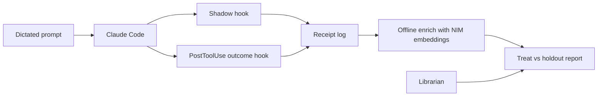

# agent-router

Measures whether the skills and agents installed for Claude Code are ever used, and tests whether surfacing the right one at prompt time changes that.

   

## Why

Installed skills and agents are almost never used. On 953 real prompts, 3 percent led to a Skill-tool call (`docs/SKILL-ACTIVATION.md`). A router that picks the right library entry is only worth building if it moves that number, so this project first builds the measurement: a shadow hook that records what would have been surfaced, a holdout arm, and an offline report. Nothing is injected into any session yet.

## How it works



The `UserPromptSubmit` hook writes one receipt per prompt (hash, length, ids; never text) and prints nothing. A second hook records whether a Skill, Agent or Task call followed. Enrichment, the librarian and the report run offline from `scripts/nightly.sh`. Details and four more diagrams: [docs/ARCHITECTURE.md](docs/ARCHITECTURE.md).

## Measured so far

| Measure | Result | Source |
|---|---|---|
| Silver labels (2 of 3 LLM judges agree) | 517 of 1,011 prompts | `eval/` |
| Retrieval top-1 / top-3, lexical | 11% / 21% | `HANDOFF.md` |
| Retrieval top-1 / top-3, dense NIM embed | 25.0% / 46.0% | `HANDOFF.md` |
| Existing `router.py` top-1 / top-3 | 28.2% / 42.6% | `eval/baseline_router.py` |
| Compiler vs raw first 300 chars, top-3 | +1.2 pp (bar was 5 pp) | `eval/compile_test.py` |
| A/A replay: treat vs holdout follow rate | 1.7% vs 1.6%, p=0.89 | `backbone aa-replay` |
| Always-guess floor, top-1 | 14.1% | `HANDOFF.md` |
| Judge agreement | about 41-47% | `HANDOFF.md` |

Silver labels are made by LLM judges and have not been verified by a human; treat every retrieval number as a development signal, not truth. On the frozen test split dense top-1 (17.7%) is below the always-"research" guess (25.8%), so no routing claim is made.

## Quickstart

```sh
python3.13 -m venv .venv
.venv/bin/pip install -r requirements.txt

# NIM keys come from the environment; values are never printed or stored
~/.claude/scripts/with-env NIM_1 NIM_2 NIM_3 -- .venv/bin/python -m backbone enrich

# no network, no keys
.venv/bin/python -m backbone ask --dry "fix the failing test in the router"
.venv/bin/python -m backbone compile --no-llm "dictated text"
.venv/bin/python -m backbone library counts
.venv/bin/python -m backbone router-report

# shadow hook (writes a timestamped backup of settings.json first)
python3 scripts/shadow_hook.py status
python3 scripts/shadow_hook.py install
python3 scripts/shadow_hook.py uninstall --dry-run
python3 scripts/shadow_hook.py uninstall

# tests take about 100 s: run in the background
.venv/bin/python -m pytest tests -q > /tmp/tests.log 2>&1 &
```

## Commands

| Command | Purpose |
|---|---|
| `backbone ask` | Free text to class, tier and gated packet; `--dry` runs nothing |
| `backbone run` | Run one task: `[/command] [#project] [@worker] prompt` |
| `backbone fanout`, `backbone swarm` | Parallel prompts, or a planner that splits a goal |
| `backbone compile` | Dictation to a compact card, entities kept verbatim |
| `backbone library` | `ingest`, `counts`, `embed`, `search` over the skill and agent catalog |
| `backbone router-report` | Treat vs holdout follow rate from live receipts |
| `backbone enrich` | Fill `would_surface` on receipts (NIM embeddings) |
| `backbone aa-replay` | A/A replay of the measurement pipeline |
| `backbone librarian` | Propose-only catalog report written to `docs/archive/research/` |
| `backbone doctor` | Probe every detected worker with one tiny call |
| `backbone plan "<prompt>"`, `plan --table` | Deterministic plan (class, worker, compiled command); what the bandit learned |
| `backbone digest [--write]` | Watcher snapshot of enforcement, Nina's router calls, runs and bandit; written hourly to `~/.agent-router/digest/` (launchd locally, cron on Oracle) |
| `backbone submit`, `jobs`, `daemon`, `runs` | Queued jobs and run history |
| `backbone serve`, `node` | Loopback hub API and an outbound-only node |
| `backbone discover`, `init`, `keys`, `mcp`, `watch`, `telegram-pair` | Setup and integrations |

## Repository layout

```
backbone/    plan, bandit, rules, enforce (decision layer); hook, hook_log, compile, health, cli; workers (pi, claude, codex, jcode, opencode, agy)
scripts/     shadow_hook.py (installs the hooks), outcome_hook.py, nightly.sh
eval/        miner, judges, baselines, librarian, shadow_enrich, A/A replay
config/      backbone.yaml (env var names only), routes.yaml (conditional rules), opencode-nim.json, agy-allow.json
library/     bundles = persona + command + hook + loop + gate (checked by eval/check_bundle.py)
docs/        architecture, roadmap, invariants, decisions, retro; archive/ holds old specs and research
tests/       invariants in tests/test_invariants.py
third_party/ MIT/Apache sources we take from, pinned in NOTICE.md (LiteLLM adaptive router, Portkey conditional router, jcode bench)
```

## Decision layer (what the router adds)

Take the best of what exists, add one measured thing of our own (skill: `harvest-then-improve`).

| Step | From | Ours |
|---|---|---|
| `classify` task class and size | LiteLLM complexity router idea | deterministic keywords, no LLM |
| `rules.resolve` conditions to targets and fallbacks | Portkey conditional router | `config/routes.yaml` |
| `bandit.pick` Thompson sampling per (class, worker) | LiteLLM adaptive router | reward is the hard gate result; decays at the cap instead of freezing; no gate, no learning |
| `plan` compiles command and a worker-shaped prompt | none | `backbone plan "<prompt>"`, `--table` shows what was learned |
| `enforce` PreToolUse on Agent/Task | none | blocks a heavy call once with the exact router command; repeat, `model: haiku/sonnet`, `ROUTER-OK`, light tasks and a 20% holdout go through |

Executors: `claude`, `codex`, `pi` on NIM_1..3, `jcode`, `opencode` (via the local NIM proxy on :8787), `agy` (read-only allow-list). The router loads only the NIM keys it needs; no wrapper.

## Safety and invariants

Each rule below is a test in `tests/test_invariants.py` (`docs/INVARIANTS.md`).

- Shadow only: the hook logs and prints nothing into the session (I4).
- Fail open: bad input gives empty stdout and exit 0 (I2).
- Hashes, not prompts: receipts hold a hash and a length (I3).
- No LLM client or network in the hooks (I1); cold start 30 ms p50, 33 ms p95.
- The librarian proposes only; archive is reversible; nothing moves without owner approval.
- Private data (`eval/heldout*`, `data/`, `logs/`, `.env`) is gitignored and was never committed.

## Status and roadmap

| Step | Gate | State |
|---|---|---|
| Owner spot-check of silver labels | at least 70% OK, Wilson lower bound 0.7 | not done |
| A/A and 2 weeks of receipts | A/A OK, receipts for 100% of prompts | A/A OK; collecting |
| Routing bar (dev only) | top-3 at least 46%; label precision 60% at 25% coverage | not run |
| Prompting bar | compiled beats raw by 5 pp top-3 | +1.2 pp, failed |
| Hook latency | p95 under 300 ms, 20 cold runs | 33 ms p95, FTS5 variant pending |
| Live injection | 20% holdout; metric is Skill calls per prompt | blocked on the above |

Plan: `docs/MVP-2026-11-13.md`, `docs/ROADMAP-2026-11-13.md`. Current state: `HANDOFF.md`.

## Prior art

[meta-router](https://github.com/dmmdea/meta-router) (dmmdea) and [agent-router](https://github.com/FlorianBruniaux/agent-router) (FlorianBruniaux), both Apache-2.0. Unmodified study copies live in `third_party/` with their licenses and `third_party/NOTICE.md`. Our Python code is written independently and cites source file and line in comments. The invariants-as-tests idea comes from meta-router.

## Docs

| File | Content |
|---|---|
| [ARCHITECTURE.md](docs/ARCHITECTURE.md) | Five diagrams of the system |
| [INVARIANTS.md](docs/INVARIANTS.md) | Six enforced rules |
| [MVP-2026-11-13.md](docs/MVP-2026-11-13.md) | Minimum viable scope and gates |
| [ROADMAP-2026-11-13.md](docs/ROADMAP-2026-11-13.md) | Roadmap |
| [DECISION-MATRIX-2026-11-13.md](docs/DECISION-MATRIX-2026-11-13.md) | Build, adopt or skip decisions |
| [SKILL-ACTIVATION.md](docs/SKILL-ACTIVATION.md) | The 3 percent measurement |
| [ORACLE-HERMES.md](docs/ORACLE-HERMES.md) | Running on Oracle through Hermes |
| [QUICKSTART.md](docs/QUICKSTART.md), [STACK.md](docs/STACK.md), [COMPONENTS.md](docs/COMPONENTS.md) | Setup, stack, components |
| [VISION.md](docs/VISION.md), [AGENT_ROUTER.md](docs/AGENT_ROUTER.md), [RESEARCH-AND-REDESIGN.md](docs/RESEARCH-AND-REDESIGN.md) | Background |
| [ADAPTER-RESEARCH.md](docs/ADAPTER-RESEARCH.md), [E2E-SCOPE-PLAN.md](docs/E2E-SCOPE-PLAN.md) | Adapter and end-to-end planning |
| [README.md](docs/README.md), `complexity-budget.json`, `pi-models.example.json` | Index, size ratchet, example config |
| `appendix/`, `archive/` | Older specs and handoffs |
