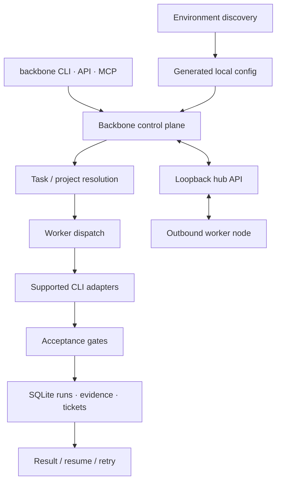

# Agent Router

A local-first, headless control plane that discovers your installed agent CLIs,
routes tasks to bounded workers, verifies outcomes, and persists jobs in SQLite.
It adapts to your tools rather than requiring a particular agent provider.

<p align="center">
  <a href="#quick-start">Quick start</a> ·
  <a href="#how-it-works">How it works</a> ·
  <a href="#cli-reference">CLI reference</a> ·
  <a href="#measurements">Measurements</a> ·
  <a href="#safety">Safety</a> ·
  <a href="#documentation">Docs</a>
</p>

<p align="center">
  <a href="https://github.com/brusnyak/agent-router/actions/workflows/ci.yml"></a>
  
  <a href="LICENSE"></a>
  
</p>

> [!IMPORTANT]
> **Experimental software.** The job runner and routing research are implemented,
> but unattended multi-machine operation and autonomous skill promotion are **not
> yet production-validated**. Review execution permissions and approval gates before
> connecting real infrastructure.

## What it is

The `backbone` CLI is an environment-aware orchestration foundation:

- **Discover:** inventory installed agent CLIs, credential env-var names, SSH aliases,
  and Git projects — without printing secret values.
- **Configure:** `backbone init` generates local config under `~/.agent-router/`
  from what discovery finds; review it before running jobs.
- **Dispatch:** route a task to a supported worker or select one explicitly with
  `--worker`. `workers.py` defines 11 dedicated CLI adapters (pi, claude, codex,
  jcode, opencode, goose, omp, cline, OpenHands, agy, kilo); any other discovered
  CLI can run through the `generic` adapter (argv-only, allowlisted, bounded).
- **Delegate:** `fanout` runs independent prompts in parallel; `swarm` splits a
  goal among workers; `submit` queues work for the daemon.
- **Verify:** each run uses a named acceptance gate (config `gates:`), retries
  within limits, and records results/evidence in SQLite.
- **Persist:** SQLite jobs, runs, leases, and LangGraph checkpoints; restart
  recovery via `adopt_orphans`.
- **Operate remotely:** loopback hub API (`serve`) plus outbound-only worker node
  (`node`) over HTTP/SSH tunnel.

## Quick start

Requirements: Python 3.13 (minimum not established). One or more supported agent
CLIs installed and authenticated for actual worker execution. NVIDIA NIM credentials
for NIM-backed workers/embedding.

```bash
git clone https://github.com/brusnyak/agent-router.git
cd agent-router
python3.13 -m venv .venv
.venv/bin/python -m pip install -r requirements.txt

# One command instead of a shell block
make                    # show targets
make install            # venv + pip install
make discover           # inventory CLIs, keys, projects, SSH hosts
make init               # write ~/.agent-router/backbone.yaml (review first)

# Explore without executing an agent
make compile text="Fix failing tests in my project"
make doctor             # probe workers (read-only)

# Run a worker (may consume account allowance)
make run prompt="Review this project" worker=codex gate="noop"

# Queue background work
make test               # ~110 s locally; CI runs the same suite on a clean runner
```

`init` is non-destructive: it refuses to overwrite an existing `backbone.yaml`.

## How it works



Core orchestration is CLI-driven. Adapter discovery and execution capability are
deliberately distinct: a CLI appearing in `discover` output does **not** mean it is
execution-ready — `workers.py` defines 11 dedicated CLI adapters (pi, claude, codex,
jcode, opencode, goose, omp, cline, OpenHands, agy, kilo), plus a direct NIM API lane
and a persona lane; `config/backbone.yaml` ships entries for 9 of the CLIs. Everything
else goes through the `generic` adapter or stays inventory-only.

The skill-routing experiment is separate from execution: a Claude Code shadow hook
records hashed prompt receipts and later tool-use outcomes, then offline jobs
evaluate whether skill suggestions would be useful. It does **not** inject
suggestions into live sessions.

## Capabilities

| Area | Implementation | Maturity |
| --- | --- | --- |
| Environment discovery | 11 CLI names, 6 provider-key patterns, SSH aliases, Git roots | Implemented; limited inventory scan |
| Local setup | `discover` → `init` generated config | Implemented; non-destructive, not zero-config |
| Worker execution | 11 CLI adapters in `workers.py` (9 configured by default) | Implemented; other CLIs via `generic` adapter |
| Dispatch | explicit worker, `ask`, `fanout`, `swarm` | Implemented; validate routes on your setup |
| Acceptance | named gates, retries, isolated workspaces, tickets | Implemented |
| Durable execution | SQLite jobs, leases, LangGraph checkpoints | Implemented; restart recovery tested |
| Remote workers | loopback hub + outbound node | Implemented; real host-to-host smoke pending |
| Skill discovery | library ingest, hybrid retrieval, prompt compiler | Research-stage |
| Prompt hooks | shadow receipts, holdout measurement, offline report | Shadow only; not injected live |
| Skill maintenance | propose-only librarian | No automatic promotion |

## CLI reference

| Command | Purpose |
| --- | --- |
| `backbone discover` | Detect CLIs, projects, hosts |
| `backbone init` | Create local configuration (non-destructive) |
| `backbone doctor` | Probe workers with a small real call |
| `backbone run "..."` | Run a task now (`--worker`, `--gate`, `--cwd`) |
| `backbone delegate "..."` | Split a goal into bounded subagents (split → fanout → integrate → gate) |
| `backbone fanout "..." "..."` | Parallel independent tasks |
| `backbone swarm "..."` | Split a goal among workers |
| `backbone submit "..."` | Queue work for the daemon |
| `backbone daemon` | Consume queued jobs |
| `backbone jobs list` | Show queued/blocked jobs |
| `backbone runs list` | Show execution history |
| `backbone runs show ID` | Inspect an execution |
| `backbone runs recover` | Recover stale runs |
| `backbone library counts` | Inspect catalog counts |
| `backbone library search "..."` | Search catalog items |
| `backbone tickets [--dir]` | Submit eligible vault tickets to queue |
| `backbone serve --port 8799` | Loopback hub API |
| `backbone node --hub URL --name N` | Outbound worker node |
| `backbone mcp` | MCP integration |
| `backbone router-report` | Shadow-hook measurement report |
| `backbone librarian` | Propose catalog maintenance |

Use `python -m backbone --help` and each subcommand's `--help` for full options.

## Measurements

All figures are **development signals, not production routing accuracy**. Sources are local measurements unless noted.

| Evaluation | Result | Source |
| --- | --- | --- |
| Silver-labeled prompts (LLM-judged, human-unverified) | 517 / 1,011 | `eval/heldout_v2` |
| Dense NIM retrieval, top-1 / top-3 | 25.0% / 46.0% | `HANDOFF.md` |
| Existing local router, top-1 / top-3 | 28.2% / 42.6% | `eval/baseline_router.py` |
| Prompt compiler, top-3 vs raw | +1.2 pp (gate was +5 pp) | `eval/compile_test.py` |
| Silver labels, dense retrieval | `eval/heldout_v2` is gitignored: numbers cannot be re-derived from the repo | `docs/ROADMAP-2026-11-13.md` |
| Shadow A/A, treat vs holdout | 1.7% vs 1.6%, p=0.89 | `backbone aa-replay` |
| Always-guess floor, top-1 | 14.1% | `HANDOFF.md` |
| Judge agreement | ~41–47% | `HANDOFF.md` |
| Cold shadow-hook p95 | 33 ms | local measurement |
| Skill-tool activation (953 prompts) | ~3% (32 calls, 14 sessions) | `docs/SKILL-ACTIVATION.md` |

On the frozen test split, dense top-1 was 17.7%, below a 25.8% majority-class
baseline, so no routing claim is made. See `docs/SKILL-ACTIVATION.md` for the full
evidence review.

Executor benchmark (3 gated tasks per worker, isolated worktree):

| worker | gate pass | wall s | notes |
| --- | --- | --- | --- |
| pi nim1 / nim2 / nim3 | 3/3 each | 11–20 | free NIM keys |
| claude | 3/3 | 18–24 | own subscription |
| jcode | 3/3 | 24–35 | ~29k input tokens per call |
| codex | 3/3 | 46–64 | slowest |
| opencode | 0/3 first run; fixed run passed | 35–113 | first run wrote to main repo, not worktree |

## Safety

- Model-provided working directories are checked against configured projects /
  `allowed_roots`; model-selected gates are looked up by name (no raw shell gates).
- Write-capable tasks default to an isolated workspace; `--no-isolate` runs in place.
- Bounded worker timeouts, retries, status records, and blocked tickets.
- Shadow hook: no network or LLM client on the prompt-hook path; prompt text is not
  stored in receipts; hook errors fail open.
- Vault tickets require `execution_authority: preauthorized-internal`, a named gate,
  and budget/timeout within the cap; `DONE_CMD` from a ticket is never executed.

These are code-level controls, not a security sandbox certification. Enforce OS-level
isolation and credential least privilege where workers receive shell access.
See `docs/INVARIANTS.md` and `docs/ARCHITECTURE.md`.

## Documentation

| Start here | What you'll find |
| --- | --- |
| [Quickstart](docs/QUICKSTART.md) | Setup and first commands |
| [Architecture](docs/ARCHITECTURE.md) | Routing, execution, checkpoints, remote nodes |
| [Components](docs/COMPONENTS.md) | Build vs reuse decisions |
| [Stack](docs/STACK.md) | Retrieval design and local model measurements |
| [Invariants](docs/INVARIANTS.md) | Tested hook and safety constraints |
| [MVP](docs/MVP-2026-11-13.md) | Minimum scope and acceptance criteria |
| [Roadmap](docs/ROADMAP-2026-11-13.md) | Planned work and evaluations |
| [Handoff](HANDOFF.md) | Recorded project state and next gates |
| [Skill activation](docs/SKILL-ACTIVATION.md) | The 3% measurement and evidence review |

## Development

```bash
# Run the test suite (same suite CI runs on a clean runner)
.venv/bin/python -m pytest tests -q

# Inspect hook installation without modifying settings
python3 scripts/shadow_hook.py status

# Preview nightly offline work
NIGHTLY_DRY=1 sh scripts/nightly.sh
```

## License

MIT. `third_party/` contains separately licensed Apache-2.0 reference copies of
meta-router and FlorianBruniaux/agent-router; see `third_party/NOTICE.md`.

---

<sub>Agent Router is independent of the Pi, Claude Code, Codex, and NVIDIA projects.
Support for a CLI or service does not imply affiliation or endorsement.</sub>
