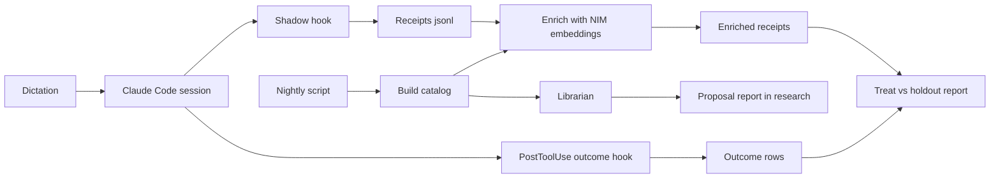
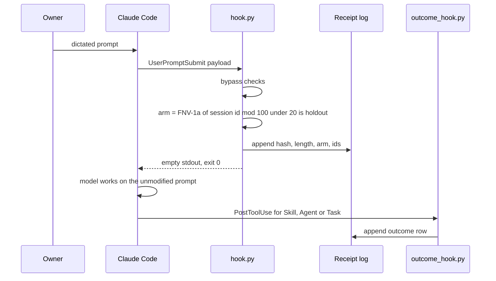
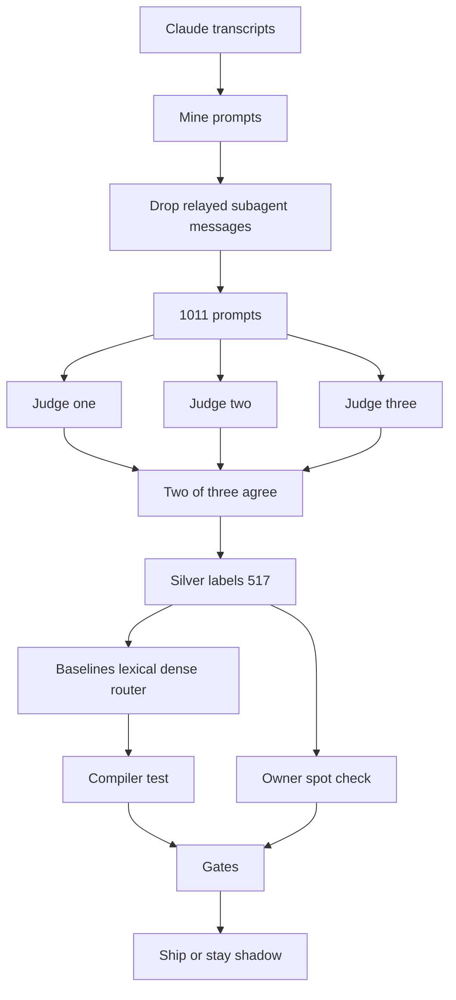
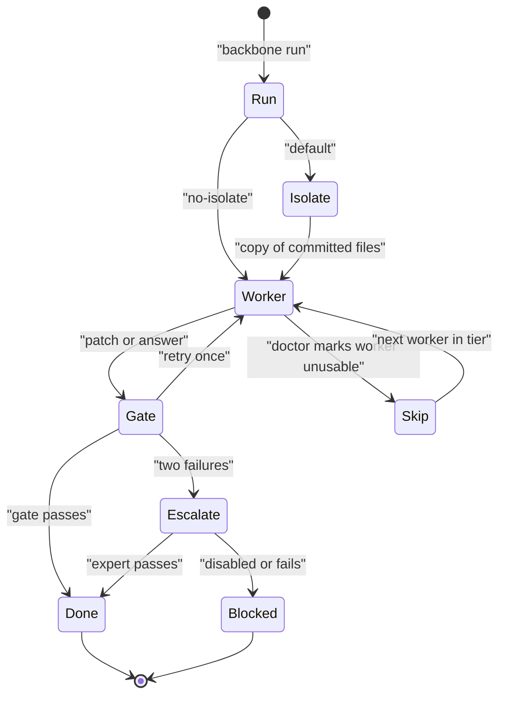
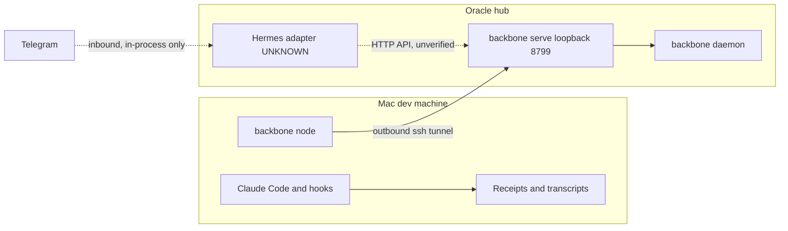

# Architecture

Five views of the system. Everything on the prompt path is shadow only: it records, it does not inject. State is as of 2026-11-13 (`HANDOFF.md`).

## 1. System

A dictated prompt reaches Claude Code, which fires the shadow hook (`backbone/hook.py`). The hook appends a receipt to `~/.agent-router/hook-shadow.jsonl`. A PostToolUse hook (`scripts/outcome_hook.py`) records Skill, Agent and Task calls. Offline, `scripts/nightly.sh` rebuilds the catalog, enriches receipts with NIM embeddings, runs the librarian and writes the report.

## 2. One prompt

The hook assigns an arm from the session id: FNV-1a of the id modulo 100, below 20 is `holdout`, otherwise `treat`. Both arms behave identically in v0 because nothing is injected; the arm exists so the A/A check can prove the pipeline has no bias before live injection. Machine turns, lane children and short prompts bypass with no arm. The hook is wrapped to fail open.

## 3. Evaluation pipeline

Transcripts under `~/.claude/projects` are mined for prompts. 310 of 1,321 were relayed subagent messages and are dropped, leaving 1,011. Three LLM judges label each; where two agree the label is silver (517 of 1,011). Baselines are scored against silver, and a result counts only if it passes its gate in `docs/MVP-2026-11-13.md`. Silver is unverified, hence the owner spot-check gate.

## 4. Worker dispatch

`backbone run` takes `[/command] [#project] [@worker] prompt`. The task is copied into an isolated workspace, which sees only committed files; `--no-isolate` runs in place and is needed for uncommitted work. Workers that `backbone doctor` marked unusable (`data/doctor.json`, read by `backbone/health.py`) are skipped. A gate command checks the result. Two failed attempts escalate to the expert worker; `--escalate ''` disables that.

## 5. Topology

Oracle is the always-on hub; the Mac is the dev machine and a node. The node connects outbound only, through an `ssh -L` tunnel to the hub's loopback port 8799; nothing on the Mac listens for Oracle. Hooks, transcripts, receipts and held-out data stay on the Mac. Any chat or agent front end can talk to `backbone serve` over its OpenAI-compatible HTTP API. Hub and node are proven only in-process.

